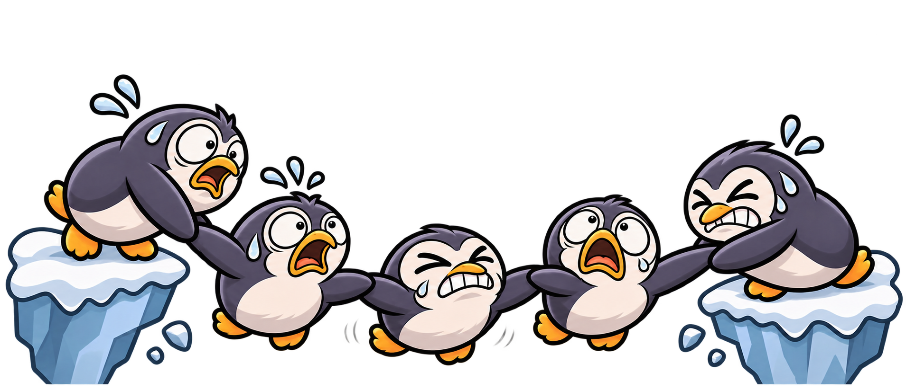
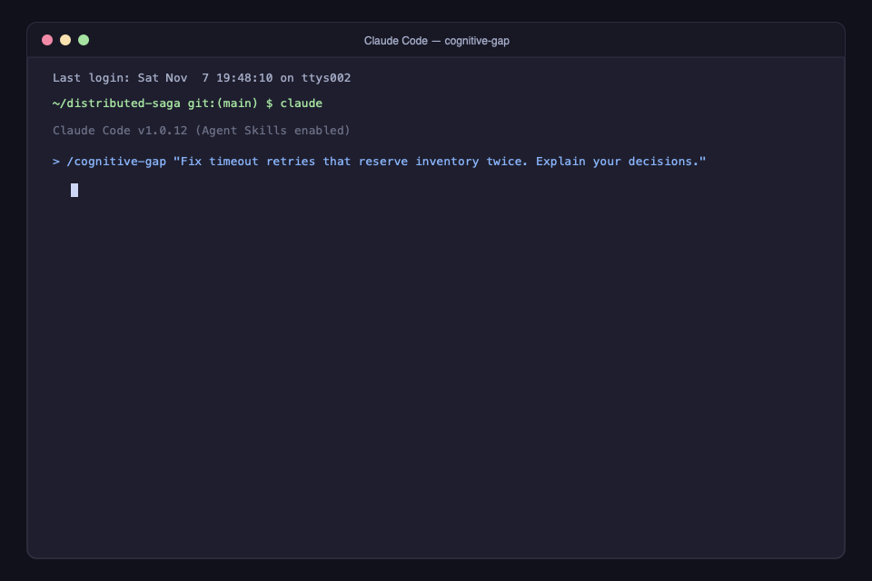
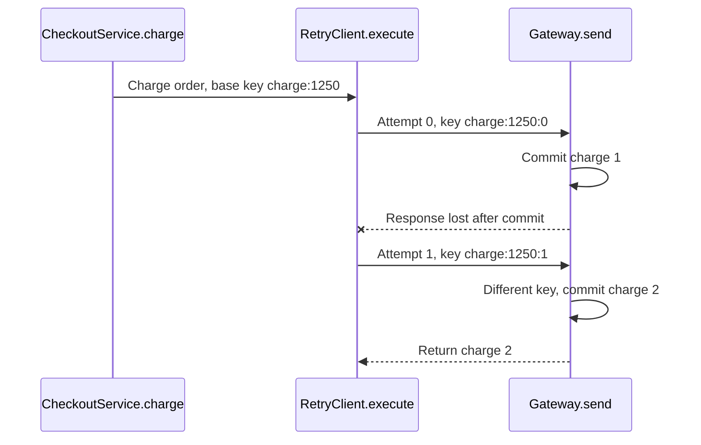

<p align="center">
  
</p>

<h1 align="center">Cognitive Gap</h1>

<p align="center"><strong>Don't just ship AI-generated code. Understand it.</strong></p>

An open-source Agent Skill that helps you understand and maintain the code you build with AI. It accompanies the whole task, from choosing an approach through implementation, debugging, and verification, across files and commits.

<p align="center">
  
</p>

## Quick start in VS Code

Open your project folder in **VS Code**, then open **Terminal → New Terminal**. Run the command for your agent:

**GitHub Copilot:**

```sh
mkdir -p .github/skills
git clone --depth 1 https://github.com/GiovanniPasq/cognitive-gap.git .github/skills/cognitive-gap
```

**Codex extension:**

```sh
mkdir -p .agents/skills
git clone --depth 1 https://github.com/GiovanniPasq/cognitive-gap.git .agents/skills/cognitive-gap
```

Open your agent's chat and give it a task:

```text
Use cognitive-gap to implement team invitations in this project.
Explain the approach before editing, then explain important decisions
as you work. Show how the main flow fits together and verify the result.
Leave me able to debug and maintain the feature.
```

Use `/cognitive-gap` in Copilot or `$cognitive-gap` in Codex to invoke it explicitly. [Installation for other agents](#install).

## Why Cognitive Gap?

We give coding agents specs, documentation, and existing code, then ask them to ship features quickly. As changes accumulate, it becomes harder to track which assumptions became implementation decisions, where behavior diverged from the spec, and why.

A **cognitive gap** opens when the code grows beyond what we can explain, verify, or confidently change. **Cognitive debt** is the effort future work inherits when those decisions must be reconstructed.

Cognitive Gap keeps the original intent, important decisions, and verification visible while the agent works, so you can follow and maintain the result.

Further reading: [Anthropic's research on AI assistance and coding skills](https://www.anthropic.com/research/AI-assistance-coding-skills) and [Microsoft Research and Carnegie Mellon's survey on AI and critical thinking](https://www.microsoft.com/en-us/research/publication/the-impact-of-generative-ai-on-critical-thinking-self-reported-reductions-in-cognitive-effort-and-confidence-effects-from-a-survey-of-knowledge-workers/).

## How it works

1. **Start from your intent.** Inspect the project, connect the request to observable behavior, and state material assumptions before modifying code.
2. **Build and explain through mechanisms.** Complete the change while explaining key tradeoffs, state transitions, and boundaries. Add a visual diagram when interactions are complex.
3. **Verify and hand back ownership.** Ground explanations in actual checks, separate verified facts from inferences, and highlight the exact files and failure points to watch.

Depth naturally follows the task: a one-line bug fix gets a concise summary; a distributed transaction gets a detailed failure-boundary trace. Routine edits keep moving without blocking approval gates.

## Example outputs

Examples from local test projects.

### A retry after the charge already committed

**Request:** *“Explain this checkout implementation with a diagram. Show existing behavior, including the bug. Don't edit anything.”*

> A timeout does not mean rollback. This implementation can charge the same order twice because each retry changes the idempotency key.



- **Mechanism:** `CheckoutService.charge` builds an amount-based key; `RetryClient.execute` appends the attempt counter. `Gateway.send` commits before simulating response loss.
- **Proposed repair:** Use a stable key identifying the order within its tenant and preserve it across retries.
- **Evidence:** Both existing fixture tests passed, but a separate post-commit timeout simulation reproduced two charges.

<details>
<summary>A rolling migration with green tests</summary>

**Request:** *“Review only the staged rollout. Can old workers and queued events coexist with the new version? Don't edit anything.”*

> Do not ship this staged rollout under the documented compatibility contract.
>
> The migration renames a column that live old workers still read. New producers emit an event format that old consumers cannot read, while new consumers reject queued old events. Converting integer cents through floating point also loses precision: `9007199254740993` becomes `9007199254740992`. The new outbox key omits the tenant ID, allowing cross-tenant key collisions.
>
> All three local tests passed. Separate in-memory reproductions demonstrated those failures. The passing suite covers ordinary new-version behavior; it does not establish mixed-version rollout safety.

The review distinguishes the staged candidate from unstaged repairs and leaves working-tree drafts intact.

</details>

## Install

The skill uses the open [Agent Skills format](https://agentskills.io/specification). Choose the directory and invocation for your agent:

| Agent | Project skills directory | User skills directory | Invoke |
| :--- | :--- | :--- | :--- |
| [GitHub Copilot](https://code.visualstudio.com/docs/agent-customization/agent-skills) | `.github/skills/` | `~/.copilot/skills/` | `/cognitive-gap` |
| [Codex](https://learn.chatgpt.com/docs/build-skills) | `.agents/skills/` | `~/.agents/skills/` | `$cognitive-gap` |
| [Claude Code](https://code.claude.com/docs/en/skills) | `.claude/skills/` | `~/.claude/skills/` | `/cognitive-gap` |
| [Cursor](https://cursor.com/help/customization/skills) | `.cursor/skills/` or `.agents/skills/` | `~/.cursor/skills/` | `/cognitive-gap` |
| [Antigravity](https://antigravity.google/docs/skills) | `.agents/skills/` | `~/.gemini/config/skills/` | Mention `cognitive-gap` by name |
| [Windsurf / Devin](https://docs.devin.ai/desktop/devin-local/customizations#skills) | `.devin/skills/` or `.agents/skills/` | `~/.config/devin/skills/` | `/cognitive-gap` |

**Cursor and Antigravity:** use the `.agents/skills/` command in the quick start.

**Claude Code:**

```sh
mkdir -p .claude/skills
git clone --depth 1 https://github.com/GiovanniPasq/cognitive-gap.git .claude/skills/cognitive-gap
```

**Devin Desktop:**

```sh
mkdir -p .devin/skills
git clone --depth 1 https://github.com/GiovanniPasq/cognitive-gap.git .devin/skills/cognitive-gap
```

Existing Windsurf setups can use `.windsurf/skills/cognitive-gap/`. For all projects, clone into the user directory in the table. Keep `SKILL.md`, `LICENSE`, and `references/` together when copying manually. The skill needs no runtime dependencies or additional API keys.

## Use it

Alongside building features, you can ask:

- **Debug:** “Use cognitive-gap to fix this retry bug. Explain the cause and verify the repair.”
- **Understand existing code:** “Use cognitive-gap to explain this cache PR. Trace the flow and compatibility boundary. Don't edit the code.”
- **Draft a PR description:** “Use cognitive-gap to draft a PR title and description for this branch. Explain the mechanism, important invariants, and verification evidence.”
