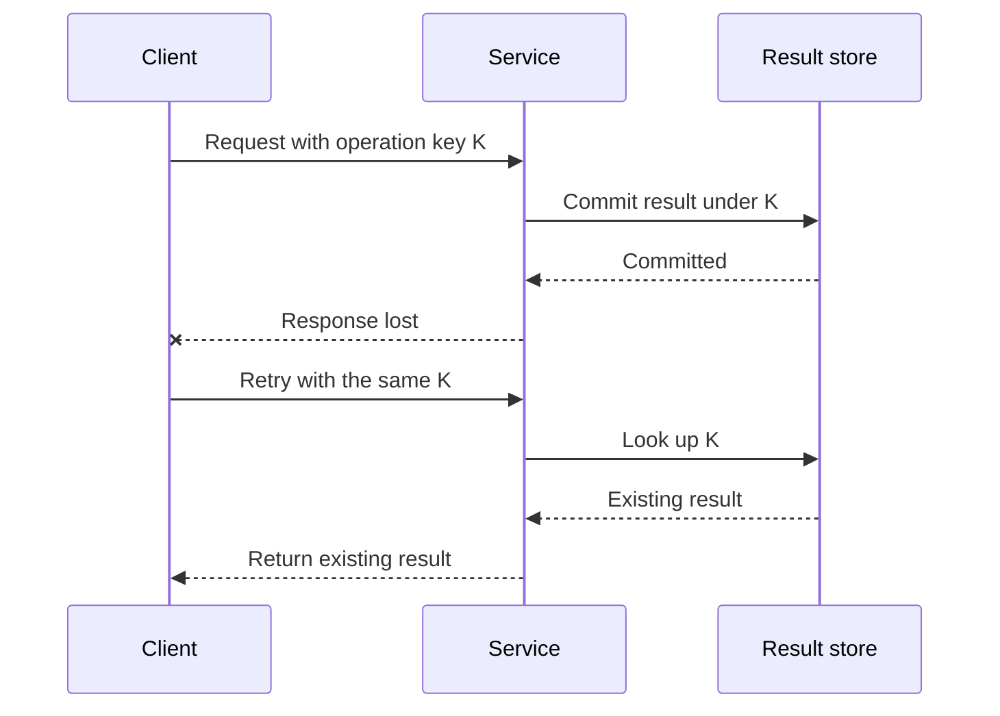

# Visual explanations

Use a visual to answer a specific question about the code. A small diagram should make the important relationship easier to see and give the developer a useful mental model for their next decision.

## Produce the explanation

1. **Pick the question.** For example: “Where can a request fail after its side effect commits?” or “Which task may publish a cache result after invalidation?” Use the user's requested focus and level of detail.
2. **Trace the mechanism.** Inspect the relevant entry point, calls, storage/state changes, and failure handling in the intended version. Include only the parts needed to answer the question.
3. **Choose the shape.** Use the table below. Start with one compact diagram; split a larger explanation into focused views only when that improves readability.
4. **Draw and explain.** Give the visual a caption identifying current behavior, a particular revision, or a proposed change. Name real functions or components and put precise code pointers nearby. Explain how to read the important path and what conclusion follows.
5. **Check fidelity.** Trace each arrow and branch back to code or evidence. Check the outcome, failure ordering, and ownership. Verify syntax with an available parser/renderer when practical; say whether you actually rendered it. A diagram explains a mechanism; it is not independent proof that the code works.

| Question | Useful format |
| --- | --- |
| Which condition or transformation leads to this outcome? | Flowchart or data-flow diagram |
| Who calls whom, and when does a commit, timeout, or retry happen? | Sequence diagram |
| Which transitions, cancellations, or invalidations are allowed? | State diagram |
| What changed in the mechanism? | Small before/after views with explicit labels |

## Keep it grounded

- Show the relevant success path and the failure or alternative path that explains the issue. Do not make a correct-looking proposal appear to be the existing implementation.
- State meaningful boundaries: one process, a particular revision, hypothetical shared storage, or a simulated network. Keep uncertain or proposed relationships explicitly labeled.
- Use short labels and simple identifiers. Explain an unfamiliar term near the diagram. Color must not be the only way to distinguish a failure or an assumption.
- Collapse unimportant plumbing, and mention an omission if it could change the conclusion. Do not invent services, transactions, synchronization, or durability from an architectural convention.
- Connect the picture to the developer's intent: what changed, why it matters, and where to inspect or modify the mechanism next. Avoid repeating a long prose description of every arrow.

## Choose an output the host can use

Use a fenced `mermaid` block when the host supports it. Prefer simple syntax from the [flowchart](https://mermaid.js.org/syntax/flowchart.html), [sequence](https://mermaid.js.org/syntax/sequenceDiagram.html), or [state](https://mermaid.js.org/syntax/stateDiagram.html) documentation. A Mermaid source block can be supplied without claiming that the host rendered it.

Keep syntax-sensitive punctuation out of message labels when possible. In sequence diagrams, a raw semicolon ends a statement: write `Attempt 0, key K` rather than `Attempt 0; key K`. If the semicolon must appear literally, encode it as `#59;`. Use short node/participant identifiers and place detailed code expressions in the surrounding explanation. This prevents a correct account of the code from becoming an unreadable diagram because of label syntax.

When rendering is unavailable or plain text is requested, use a short ASCII flow or numbered interaction trace. Keep the same actors, branches, and takeaway. Do not repeat the diagram in multiple formats unless useful or requested.

Keep diagrams inline during ordinary explanations. If the user asks to save documentation or export an image, follow the repository's conventions or requested path. For an SVG/PNG export, render the same diagram source with available tooling, retain the editable source, and inspect the result when possible. If exporting is unavailable, provide the source and a useful inline alternative without claiming to have created an image. Installing a renderer is unnecessary for a text explanation.

## Illustrative sequence

The following is a **schematic proposed stable-key retry**, not a diagram of an inspected repository. Substitute actual symbols and verify that its guarantees hold before using a similar flow. Concurrency and storage durability are omitted from this view.



Takeaway: the client can observe a failure after a side effect has committed. Reusing an operation key can recover the prior result when the implementation and storage contract support that guarantee.

The equivalent fallback can be compact:

```text
Client -> Service -> Result store: commit under K
Client <- X response lost after commit
Client -> Service -> Result store: retry, look up the same K
Client <- Service: return existing result
```
